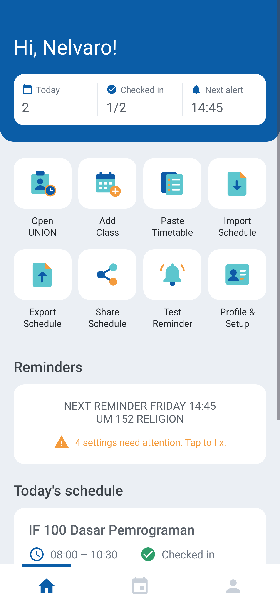
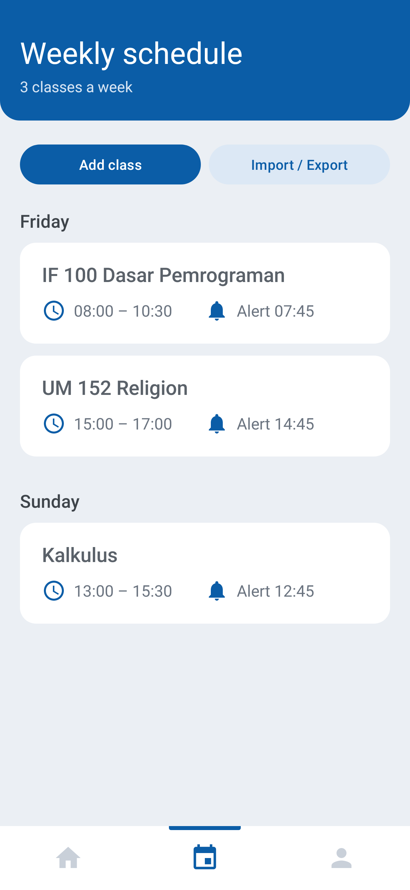
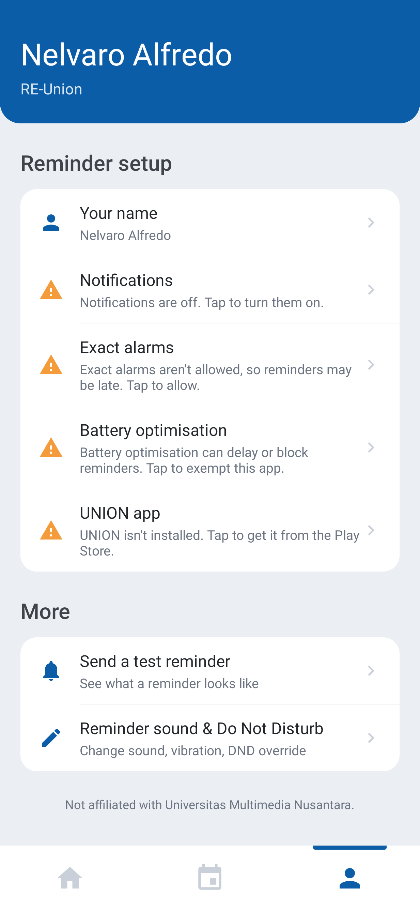

# RE-Union

Attendance reminders for **UNION – UMN Companion**: never forget to check in to class.

A small Android app that makes sure you never forget to check in on
**UNION – UMN Companion** (`umn.union`).

<p>
  
  
  
</p>

Styled after UNION: blue header with a stats card, a tile grid for every action, white
schedule cards and a bottom tab bar (Home, Schedule, Profile).

## What it does

For every class in your weekly timetable:

| When | Notification |
| --- | --- |
| 15 minutes before class starts | "**Calculus starts in 15 minutes**" |
| At the start, then every 15 minutes while the class is running | "**You haven't checked in to Calculus!**" |

- **Tapping the notification counts as checking in**: it opens UNION and stops the
  reminders for that class today. If UNION isn't installed, it opens its Play Store page.
- If you never tap it, the reminders keep coming every 15 minutes until the class ends,
  then the notification disappears by itself.
- You can also mark a class as checked in (or undo it) with the button next to it in the
  app.

### Priority notifications

- High-importance channel: pops up as a heads-up banner, with sound and vibration, and is
  shown in full on the lock screen.
- Marked as an alarm-category, max-priority notification that is pinned (ongoing) until
  you tap it or the class ends. Swiping it away only hides it until the next 15-minute
  reminder.
- Exact alarms are used so reminders arrive on the minute, also in Doze, and are
  re-armed after a reboot, app update or time zone change.

## Install

1. Download [`dist/re-union-1.3.1.apk`](dist/re-union-1.3.1.apk) to
   your Android phone (Android 8.0 or newer).
2. Open it and allow "Install unknown apps" when asked.
3. Open **RE-Union** and allow notifications. Tap your greeting to set your
   name. If the home screen says settings need attention, tap it: the **Profile** tab lists
   each one, and tapping it takes you to the right setting:
   - **Battery optimisation**: exempt the app. On Xiaomi/Oppo/Vivo/Samsung phones, also
     allow *Autostart* / set battery to *Unrestricted*, or the system may kill reminders.
   - **Exact alarms** (Android 12 only): allow.
4. Enter your timetable. Either:
   - Tap the **Paste Timetable** tile, paste your schedule (copied from UNION, myUMN, a spreadsheet
     or a chat), tap **Read schedule**, check the preview, then **Replace schedule**; or
   - Tap the **Add Class** tile for each class: name, day, start time, end time.

   Tap a class card to edit or delete it.

### Import and export

From the home tiles, or **Import / Export** on the Schedule tab:

- **Export to file**: saves your schedule as a `.json` file (backup, or move it to a new
  phone).
- **Import from file**: opens an exported `.json` file, or any text file in one of the
  paste formats below. You get a preview first, then choose **Replace schedule** or
  **Add**.
- **Share schedule**: sends it as text (WhatsApp, LINE, etc.), one class per line, e.g.
  `Monday 08:00-10:30 Dasar Pemrograman`. A friend can paste it into
  **Paste timetable** to copy your schedule.
5. Tap the **Test Reminder** tile to see what a reminder looks like.

Optional: to get reminders even in Do Not Disturb, go to
*Settings → Notifications → Do Not Disturb → Apps* and add RE-Union.

### Paste formats

Each class needs a day (Indonesian or English, e.g. *Senin* / *Monday* / *Mon*) and a
start and end time (`08:00`, `08.00`, `08:00 - 10:30`, `08.00 s/d 10.30 WIB`). These all
work:

```
Senin 08:00-10:30 Dasar Pemrograman
Rabu, 13.00 - 15.30 WIB Kalkulus
```

```
Monday
08:00 - 10:30  IF100 Algorithms
13:00 - 14:40  Physics
```

A table copied from a spreadsheet (tab-separated):

```
Selasa	IF120 Discrete Math	08.00	10.30	B501
```

```
Hari: Jumat
Mata Kuliah: Pancasila
Jam: 09:00 - 11:30
```

Lines without a day are listed as skipped in the preview so you can fix them.

## Build from source

Requires JDK 17+ and the Android SDK (platform 35).

```sh
./gradlew assembleRelease   # APK at app/build/outputs/apk/release/app-release.apk
./gradlew testReleaseUnitTest
```

The release build is signed with the debug key so it can be sideloaded directly.

## Code layout

- `Scheduler.kt`: works out every reminder time for the coming week and keeps one exact
  alarm armed for the next one.
- `AlarmReceiver.kt`: fires at each reminder time, posts the notification(s), arms the
  next alarm.
- `Notifier.kt`: notification channel, notification content, launching UNION.
- `CheckInActivity.kt`: runs when you tap a reminder: marks the class as checked in and
  opens UNION.
- `ScheduleParser.kt`: reads a pasted timetable.
- `ScheduleFile.kt`: schedule export/import (JSON file and shareable text).
- `BootReceiver.kt`: re-arms alarms after reboot, update or clock change.
- `ClassStore.kt`: timetable and check-in marks (stored on the device).
- `MainActivity.kt`: UNION-style Home, Schedule and Profile tabs, timetable editor.

Not affiliated with Universitas Multimedia Nusantara.
